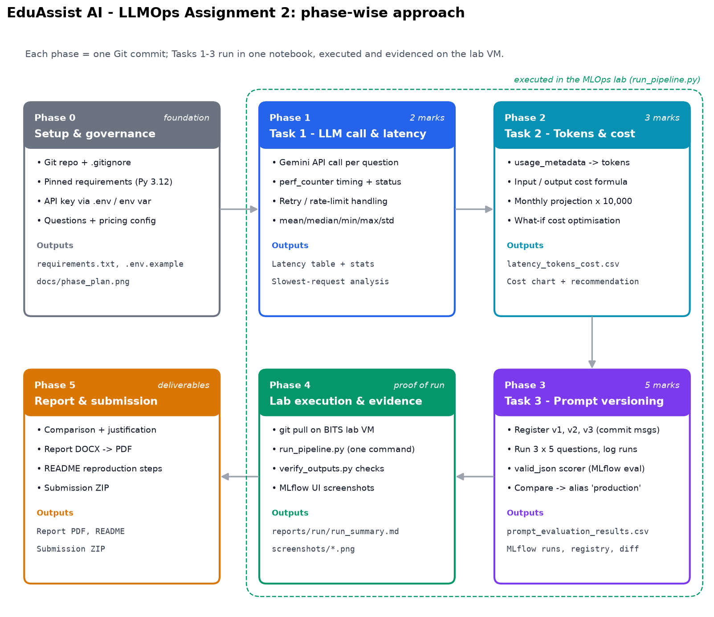

# EduAssist AI — LLMOps: API Cost, Latency and Prompt Version Management

MLOps (AIMLCZG523) Experiential Learning Assignment 2 — Sivaram Gudlavalleti (2025ae05220)

An academic question-answering assistant is operationalised as an LLM application: every
request's latency and token usage are measured, converted to cost with published pricing, and
three prompt versions are registered, evaluated and promoted in the **MLflow Prompt Registry**.

| | |
|---|---|
| Notebook (executable, all tasks) | [`notebooks/EduAssist_LLMOps_Assignment2.ipynb`](notebooks/EduAssist_LLMOps_Assignment2.ipynb) · HTML export in `reports/` |
| CSV outputs | [`outputs/latency_tokens_cost.csv`](outputs/latency_tokens_cost.csv) · [`outputs/prompt_evaluation_results.csv`](outputs/prompt_evaluation_results.csv) |
| Lab run evidence | [`reports/run/run_summary.md`](reports/run/run_summary.md) · [`screenshots/`](screenshots/) |
| Lab procedure | [`LAB_RUNBOOK.md`](LAB_RUNBOOK.md) |

## Phase-wise approach



| Phase | Scope | Marks | Output |
|---|---|---|---|
| 0 | Repo, pinned environment, secrets via `.env`, questions + pricing config | – | `requirements.txt`, `.env.example`, `data/questions.json` |
| 1 | Task 1 — call Gemini for 5 questions, measure latency, statistics, slowest-request analysis | 2 | latency table + stats + chart |
| 2 | Task 2 — tokens from `usage_metadata`, cost formula, 10,000-request projection, what-if optimisation | 3 | `latency_tokens_cost.csv` |
| 3 | Task 3 — register v1/v2/v3, evaluate on the same 5 questions, `valid_json` scorer, promote to `production` | 5 | MLflow runs + registry, `prompt_evaluation_results.csv` |
| 4 | Lab execution with `run_pipeline.py`, automatic verification, MLflow screenshots | – | `reports/run/`, `screenshots/` |
| 5 | Report (DOCX → PDF), README, submission ZIP | – | `reports/` |

## Model, API and pricing

| | |
|---|---|
| Provider / model | Google Gemini API, `gemini-3.5-flash-lite` (thinking at its default `minimal` level, temperature 0, max 2,048 output tokens) |
| API version | Gemini API `v1beta` via `google-genai` 2.34.0 |
| Pricing | $0.30 input / $2.50 output per 1M tokens, paid Standard tier — [ai.google.dev/gemini-api/docs/pricing](https://ai.google.dev/gemini-api/docs/pricing), page dated **2026-10-30** |
| Currency | USD |
| Billing note | calls run on the free tier ($0 billed); all costs are what the same traffic costs on the paid tier |
| Model choice | Gemini 2.5 access is limited to accounts that used it before, so new API keys get HTTP 404; Google recommends 3.5 Flash-Lite for new projects ([deprecations](https://ai.google.dev/gemini-api/docs/deprecations)) |

Other providers can be switched in with `LLM_PROVIDER` = `openai` | `anthropic` | `ollama`
(local open-source model, cost estimated from a comparable hosted price — brief, section 7).

## Setup and reproduction

**Python:** 3.12 (3.10+ works). **Libraries** (exact pins in `requirements.txt`): `google-genai`, `mlflow` 3.17.2
(Prompt Registry needs MLflow 3.x), `pandas`, `numpy`, `matplotlib`, `python-dotenv`, `jupyter`/`nbconvert`,
`ruff`; `openai` and `anthropic` only for the optional providers.

**Environment variables** (put them in `.env`, which is git-ignored — template: `.env.example`):

| Variable | Required | Default | Purpose |
|---|---|---|---|
| `GEMINI_API_KEY` | yes | – | Gemini API key (never hard-coded, never printed) |
| `LLM_PROVIDER` | no | `gemini` | `gemini` / `openai` / `anthropic` / `ollama` |
| `LLM_MODEL` | no | `gemini-3.5-flash-lite` | model id |
| `REQUEST_INTERVAL_SECONDS` | no | `6` | pause between calls (free-tier rate limit) |
| `MLFLOW_TRACKING_URI` | no | `sqlite:///mlflow.db` | MLflow store (SQLite needed for the Prompt Registry) |

```bash
# 1. install
python3.12 -m venv .venv && source .venv/bin/activate
pip install -r requirements.txt

# 2. secrets
cp .env.example .env          # then paste your key into .env

# 3. run everything (lint, notebook, HTML export, verification) and record the run
python scripts/run_pipeline.py --fresh

# 4. inspect in MLflow
mlflow ui --backend-store-uri sqlite:///mlflow.db --port 5000     # http://127.0.0.1:5000
```

Or interactively: `jupyter lab notebooks/EduAssist_LLMOps_Assignment2.ipynb` and *Run All*.
Lab VM specifics (conda Python, screenshots, committing results) are in [`LAB_RUNBOOK.md`](LAB_RUNBOOK.md).

## What the notebook does

* **Task 1** — `call_llm()` times only the API call with `time.perf_counter()`, stamps UTC start/end times,
  records status, HTTP attempts and finish reason, and retries 429/5xx with exponential back-off.
* **Task 2** — tokens from the response (`prompt_token_count`, `candidates_token_count`, `thoughts_token_count`),
  cost = tokens / 1,000,000 × price, monthly = average × 10,000, plus a what-if table (shorter answers,
  3.1 Flash-Lite routing) behind the recommendation.
* **Task 3** — experiment `eduassist_llmops_assignment`; prompt `eduassist-academic-qa` versions 1–3 registered
  with commit messages (idempotent on re-run); each version runs in its own MLflow run with the prompt loaded
  from the registry; `mlflow.genai.evaluate()` scores every response with `valid_json`, `schema_valid` and
  `keyword_coverage`; the comparison applies a stated rule (valid JSON gate → coverage → cost → latency) and
  moves the `production` alias; a `promotion_decision` run stores the table, chart, diffs and justification.

## Repository layout

| Path | Contents |
|---|---|
| `notebooks/` | The assignment notebook (executed in the lab) |
| `data/questions.json` | The five questions + expected concepts for the coverage score |
| `scripts/run_pipeline.py` | One-command lab runner with run summary |
| `scripts/verify_outputs.py` | Deliverable, MLflow and secret-leak checks |
| `scripts/plot_phase_plan.py` | Draws `docs/phase_plan.png` |
| `outputs/` | CSV deliverables, prompt diffs, justification, figures |
| `reports/` | HTML export, run logs, final report |
| `screenshots/` | MLflow and lab evidence |

## Security

The API key is read from the environment only; `.env` is git-ignored; the notebook prints only whether a
key is set; `verify_outputs.py` scans every output, notebook, report and MLflow artifact for the key value and
fails the pipeline if it is found.
